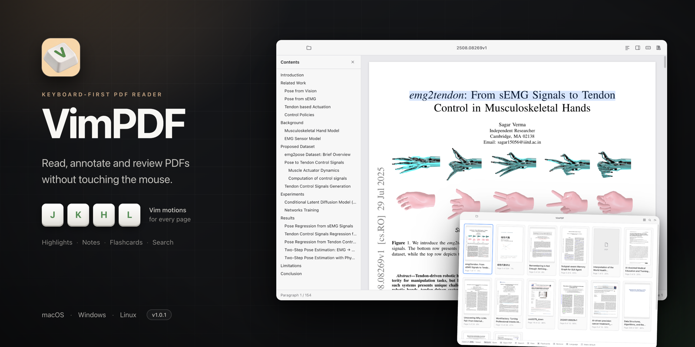

<p align="center">
  
</p>

# VimPDF

**A keyboard-first PDF reader with highlights, notes, flashcards and inline math.**
macOS · Windows · Linux — built with Electron, React and PDF.js.

VimPDF 是一个键盘优先的 PDF 阅读器：`J` / `K` 逐段移动，`[` `]` 跳转章节，`H` 高亮，`N` 记笔记，标注会自动变成复习卡片。笔记输入框支持 `$...$` 行内公式。

This is a cross-platform rebuild of the native macOS VimPDF app.

## Features

- **Library** — adaptive portrait cover grid or a compact list, title search, sort orders, remembered reading position and zoom per document.
- **Reader** — continuous pages, paragraph-level keyboard navigation, outline sidebar, occurrence-level search, annotations sidebar, clickable note markers, text-to-speech, immersive fullscreen.
- **Highlights & notes** — highlight a paragraph with `H`, write a note with `N`, both rendered with inline KaTeX math, exportable as Markdown.
- **Flashcards** — every highlight and note becomes a card in a review deck; edit inline, jump to the paragraph in one key, restore the last card you were on.
- **Bilingual UI** — 中文 / English, switchable at runtime.
- **Local-first** — the shelf, reading positions, zoom and annotations live in a local SQLite database. PDFs never leave your computer.

## Install

Download the latest build from [Releases](https://github.com/zhpencil/VimPDF/releases/latest).

The macOS build is unsigned, so Gatekeeper shows a warning on first launch. Right-click the app and choose **Open**, or clear the quarantine flag once:

```sh
xattr -dr com.apple.quarantine /Applications/VimPDF.app
```

## Keyboard shortcuts

| Key | Reading | Key | Editing |
| --- | --- | --- | --- |
| `↓` / `J` | Next paragraph | `N` | Create / edit note |
| `↑` / `K` | Previous paragraph | `H` | Highlight paragraph |
| `→` / `D` | Next page | `X` | Delete annotation |
| `←` / `U` | Previous page | `Z` | Undo |
| `[` / `]` | Previous / next section | `C` | Copy paragraph |
| `G G` | Back to the top | `E` | Export notes as Markdown |
| `G` | Last section | `Q` | Back to library |
| `T` / `B` | Contents / annotations sidebar | `⌘↩` | Save note |
| `F` | Search | `⌘=` / `⌘-` | Zoom in / out |
| `P` | Read paragraph aloud | `?` | Show / hide shortcuts |

In the library: arrows or `J K H L` select, `Return` opens, `O` opens a PDF, `F` searches, `V` switches grid/list, `N` opens the flashcard deck, `X` removes, `M` switches language.

### Inline math in notes

Wrap LaTeX in dollar signs to render it inline in notes, highlights, flashcards and exported Markdown:

```text
The energy is $E = mc^2$, so the ratio is $\frac{a}{b}$.
```

The formula renders as soon as the caret leaves it; move the caret back onto it to edit the source again.

## Development

```sh
npm install
npm run dev        # Vite + Electron with hot reload
npm run build      # type-check and bundle the renderer
npm run dist:mac   # dmg + zip (also dist:win, dist:linux)
```

PDF.js assets (CMaps, standard fonts, WASM) are copied from `pdfjs-dist` into `public/pdfjs` automatically by the `predev` / `prebuild` scripts.

## Data

Everything is stored in the Electron user-data directory for the app (`library.sqlite` plus generated cover thumbnails). The app makes no network requests.

## License

[MIT](LICENSE)
